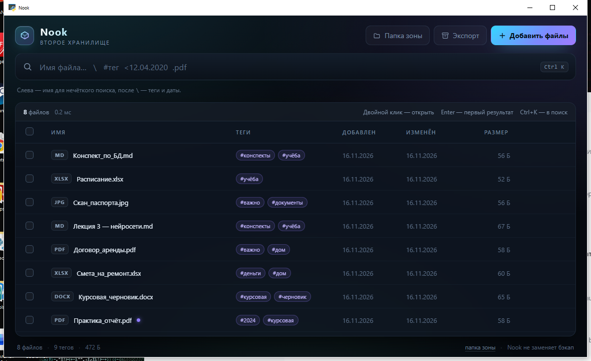
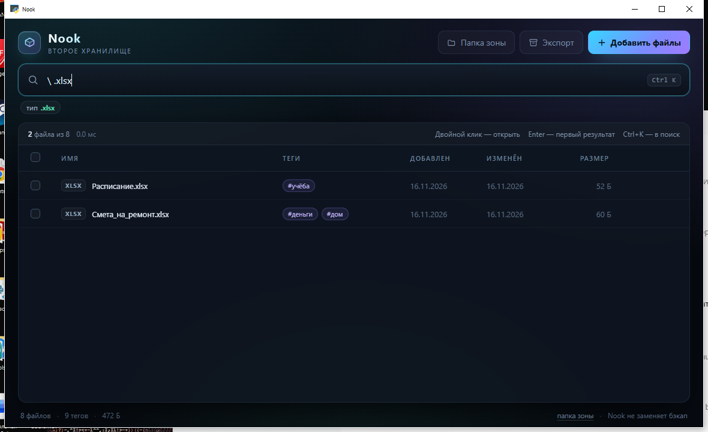

# Nook — личное хранилище документов с быстрым поиском

> Второе хранилище для «важного, но не хочу потом долго искать».
> Не бэкап, не поиск по всему диску, не облако.

Nook — маленькое окно, куда перетаскивают файл, который понадобится через
полгода. Файл физически переезжает в выбранную папку-зону, а имя, теги и дата
остаются в SQLite. Поиск — нечёткий, по нормализованному имени, отвечает за
миллисекунды.



**Nook не заменяет бэкап.** Кнопка «Экспорт» собирает zip для переноса,
а не для защиты от потери диска.

---

## Быстрый старт

```powershell
# 1. зависимости (один раз)
python -m venv venv
.\venv\Scripts\python.exe -m pip install -r requirements.txt

# 2. запуск
.\venv\Scripts\python.exe -m nook
```

Если venv уже создан рядом с проектом, достаточно второй команды. Вместо
`python -m nook` можно запускать `python main.py` — разницы нет.

Окно откроется в тёмной теме; первое добавление — перетаскиванием файлов или
кнопкой «Добавить файлы».

Что нужно установить (см. `requirements.txt`): `pywebview`, `rapidfuzz`,
`platformdirs`. `watchdog` — на будущее, `pytest` — для тестов.

## Где что лежит

| Что | Где |
|---|---|
| База, конфиг, лог запросов | `%APPDATA%\nook\` |
| Зона (файлы) | `%APPDATA%\nook\vault\files\<uuid>.<ext>` |
| Корзина | `%APPDATA%\nook\vault\trash\` |
| Экспорт | `%APPDATA%\nook\exports\` |

Папку зоны можно выбрать свою — путь хранится в `config.json`
(`vault_dir`). Для разработки и тестов каталог данных переопределяется
переменной окружения `NOOK_DATA_DIR`.

## Синтаксис поиска

```
<текст для fuzzy-поиска> \ <параметры>
```

Разделитель — `\` (клавиша над Enter, без Shift). Слева — только имя файла,
справа — жёсткие фильтры:

| Пример | Что делает |
|---|---|
| `практ` | нечёткий поиск по имени |
| `смета.xlsx` | поиск «смета» + фильтр по расширению `xlsx` |
| `смета \ .xlsx` | то же, расширение в параметрах |
| `практ \ #курсовая` | «практ» и тег `#курсовая` |
| `\ #курсовая <12.04.2020` | всё с тегом, добавленное до 12.04.2020 |
| `\ 12.04.2020 31.12.2024` | диапазон дат добавления (две даты подряд) |
| `\ [12.04.2020,31.12.2024]` | то же самое в скобках |
| `\ -#черновик` | всё, кроме тега `#черновик` |
| `-#черновик` | то же самое: запрос из одних тегов не ищет по имени |
| `договор \ -[<01.01.2024]` | «договор», добавленный не раньше 2024 года |

Даты — по дате **добавления в зону** (`added_at`), формат `дд.мм.гггг`;
понимаются также `дд.мм.гг` и `гггг-мм-дд`. Скобки необязательны: `<12.04.2020`,
`12.04.2020`, две даты подряд — диапазон. Неравенства: `<`, `<=`, `>`, `>=`.
Скобки нужны только для диапазона через запятую и для отрицания даты.
Расширение распознаётся, только если после последней точки 2–15 латинских букв:
`отчёт.2024` и `лекция.Часть1` остаются частью имени.

На русской раскладке в правой части `№` превращается в `#`, `(` и `)` —
в `[` и `]`: переключать язык не нужно. Ctrl+K (в любой раскладке) ставит
курсор в строку поиска.



## Что уже работает

- **Хранение**: плоская зона `files/<uuid>.<ext>`, человекочитаемое имя — в базе.
- **Добавление**: drag & drop (несколько файлов сразу) и кнопка с системным
  диалогом; диалог тегов и заметки перед добавлением.
- **Дедупликация**: SHA-256 содержимого; дубликат не добавляется, показывается
  «уже есть» с датой.
- **Поиск**: `rapidfuzz` (`WRatio`, порог 60) по нормализованному имени,
  фильтры по тегам, датам и расширению, миллисекунды на тысячи файлов.
- **Теги**: автодополнение, установка на существующие файлы, массовое
  проставление и снятие, переименование и слияние (лечит опечатки). При снятии
  подсказываются только теги, которые висят на выделенных файлах; набранный,
  но не подтверждённый Enter текст всё равно считается тегом.
- **Корзина**: удаление переносит файл в `trash/`; тост «Вернуть» возвращает
  файл вместе с тегами.
- **Экспорт**: zip с файлами и `manifest.json`.
- **Лог дыр**: запросы без результатов пишутся в `search_log`.
- **Метаданные**: колонки «Добавлен» и «Изменён»; полная карточка (создан,
  размер, теги, заметка) — в подсказке к строке. В узком окне колонка
  «Изменён» скрывается, чтобы таблица не разъезжалась.
- **Клавиатура**: Ctrl+K в любой раскладке — курсор в поиск, Enter — открыть
  первый результат, Esc — очистить запрос или закрыть диалог.

Ещё не сделано (осознанно отложено): фоновый `watchdog` на папку зоны,
превью файлов, импорт папки с чекбоксами, массовое удаление по критериям,
глобальный хоткей, инсталлятор.

## Структура

```
nook/
├── model/          # чистая логика, без UI
│   ├── config.py   # platformdirs, настройки
│   ├── db.py       # SQLite: схема и миграции
│   ├── dedup.py    # SHA-256
│   ├── query.py    # разбор строки поиска
│   ├── index.py    # индекс в памяти
│   ├── search.py   # фильтры + rapidfuzz
│   ├── tags.py     # теги: CRUD, слияние, чистка
│   ├── zone.py     # файлы в зоне, корзина, экспорт
│   └── library.py  # композиция модели
├── view/           # только HTML/CSS/JS
│   ├── index.html
│   ├── style.css
│   └── app.js
├── controller/     # тонкий мост JS ⇄ Python
│   └── main.py
├── cli.py          # точка входа и команды для разработки
└── __main__.py     # python -m nook
```

**MVC:** модель не знает про UI, представление — про SQLite, контроллер только
перекладывает JSON.

## CLI (для разработки)

```powershell
python -m nook add отчёт.pdf -t курсовая --note "подписанный скан"
python -m nook search "практ \ #курсовая" --json
python -m nook list
python -m nook tags
python -m nook tag #диплом 3 4
python -m nook delete 5
python -m nook restore 5
python -m nook export --out C:\temp\nook.zip
python -m nook --data-dir .\.demo stats   # изолированные данные
```

## Тесты

```powershell
.\venv\Scripts\python.exe -m pytest
```

75 тестов: разбор запросов, дедупликация, корзина, теги, ранжирование поиска,
настройки. Фикстура `tmp_path` переопределена в `tests/conftest.py`, потому что
каталоги с правами `0700` ломаются в песочницах.

## Сборка .exe

```powershell
.\venv\Scripts\python.exe -m pip install pyinstaller
.\venv\Scripts\python.exe -m PyInstaller nook.spec
```

`nook.spec` кладёт `nook/view` внутрь сборки (`datas`) и собирает `--onedir`
(`dist\Nook\Nook.exe`). Спецификация не проверена на чистой машине — это
следующий шаг; инсталлятор (Inno Setup) — после него.

## Решения, которые стоит помнить

- Дедуп только по содержимому: одинаковые имена с разным содержимым легитимны.
- Файлы на диске — `<uuid>.<ext>`: нет коллизий, имя живёт в базе.
- Теги плоские; слэш-конвенция `#учёба/курсовая` — позже и обратно совместимо.
- Уникальность тегов — по ключу `casefold` + `ё→е` в колонке `name_key`:
  SQLite `LOWER()` не понимает кириллицу.
- Удаление — всегда в корзину; `os.remove` в коде зоны нет.
